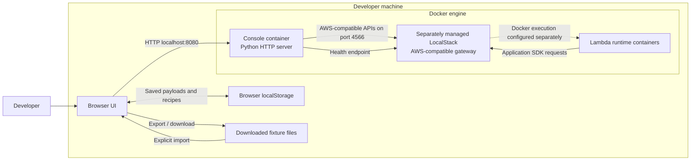
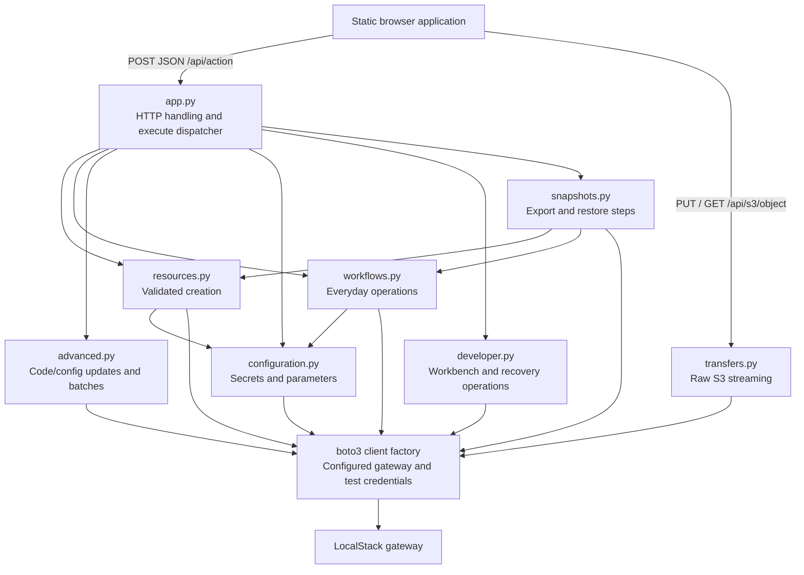
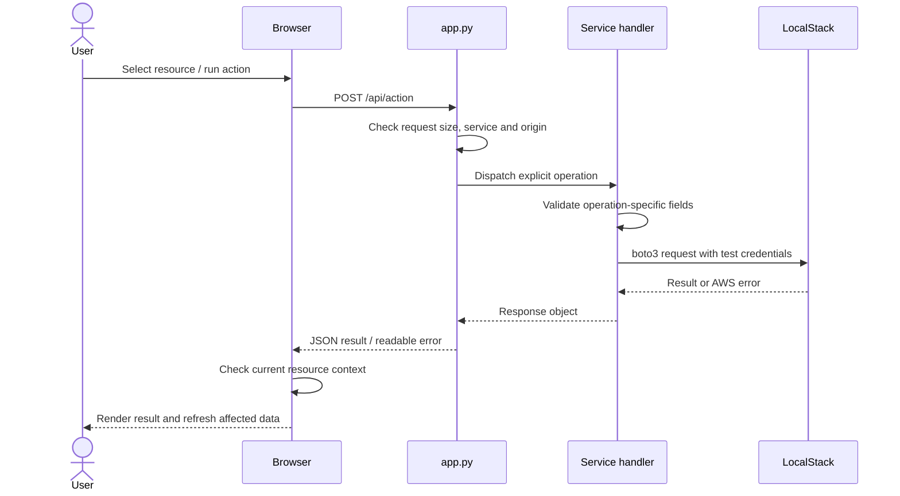
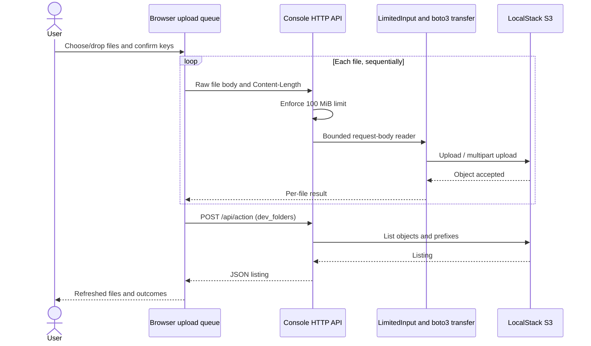
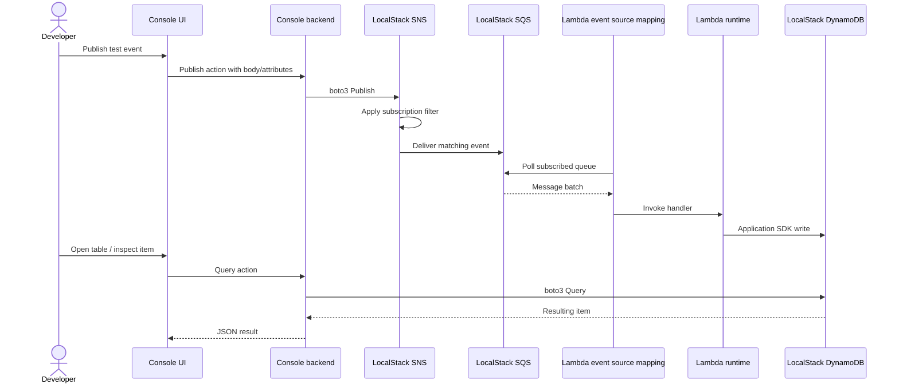

# LocalStack Console — Architecture

| Document metadata | Value |
| --- | --- |
| Date | 11 November 2026 |
| Status | As implemented in the current working tree |
| Audience | Developers, maintainers and technical reviewers |
| Runtime baseline tested | Python 3.12 console container; LocalStack Community 4.0.3 |

This document describes the implementation, including changes that may not yet be committed or pushed. It does not describe a proposed production deployment.

## 1. Purpose and boundaries

LocalStack Console is a local web application for developing and testing applications that use AWS-compatible services. It provides resource management, editable test inputs, inspection, recovery operations and reproducible development fixtures.

The seven first-class service workbenches are S3, SQS, SNS, Lambda, DynamoDB, Secrets Manager and Systems Manager Parameter Store. IAM is used internally to provision the dedicated Lambda execution role; it is not a separate console workbench. KMS key identifiers can be supplied for supported configuration resources, but key management is outside the UI.

The design targets one developer and a trusted local LocalStack instance. Authentication, authorization between users, HTTPS termination, durable console storage, distributed tracing and production AWS administration are outside the implemented architecture.

## 2. System context and deployment



### 2.1 Deployment ownership

[compose.yaml](compose.yaml) defines **only the console**. It does not create, configure, persist or upgrade LocalStack. LocalStack and its Lambda Docker execution access must be managed separately.

| Element | Implemented configuration |
| --- | --- |
| Browser entry point | `http://localhost:8080` |
| Host console binding | `127.0.0.1:8080:8080` in Compose |
| Container listener | `0.0.0.0:8080`, selected through `BIND_HOST` |
| Native Python listener | `127.0.0.1:8080` by default |
| Compose LocalStack endpoint | `http://host.docker.internal:4566` |
| Native Python LocalStack endpoint | `http://localhost:4566` |
| Default region | `eu-west-2` |
| AWS credentials | Explicit `test` / `test` on console-created SDK clients |
| Container user | UID/GID `65534:65534` |
| Python image | `python:3.12-slim` |
| Python dependency | `boto3>=1.35,<2`, with its transitive dependencies |

Docker's `host-gateway` mapping is configured for `host.docker.internal`. Where a host-bound LocalStack port cannot be reached from a container, attach the containers to a shared Docker network and configure the actual LocalStack hostname instead. There is no automatic network provisioning between the two applications.

LocalStack resource durability depends on its own configuration. The console has no database or resource-state volume and cannot guarantee resources survive a LocalStack restart.

### 2.2 Configuration

| Setting | Responsibility |
| --- | --- |
| `LOCALSTACK_ENDPOINT` | Process-wide gateway for all console AWS API clients and health checks |
| `AWS_DEFAULT_REGION` | Initial browser selection and server fallback region |
| `BIND_HOST` | Python server bind address; set to `0.0.0.0` in the image |
| Browser region selector | Per-action region override; changing region clears resource selection |
| Compose `.env` | Optional local overrides for endpoint and default region |

The browser cannot change the backend gateway through `/api/config`; that endpoint is read-only. S3 bucket listing is account-wide, while the other service lists are regional.

## 3. Component architecture



### 3.1 Backend source map

| File | Responsibility |
| --- | --- |
| [app.py](app.py) | `ThreadingHTTPServer`, static asset allowlist, configuration endpoint, JSON action routing, client factory, errors and bulk cleanup |
| [resources.py](resources.py) | Creation validation; S3 regional creation; queue/topic types; DynamoDB schemas; Lambda ZIP packaging and role setup |
| [workflows.py](workflows.py) | Object transfer through legacy JSON APIs, queue acknowledgement/visibility, subscriptions, typed items and service deletion |
| [advanced.py](advanced.py) | Lambda source/config/ZIP changes, queue batch sends, message attributes and version-aware bucket emptying |
| [configuration.py](configuration.py) | Secret/parameter creation, metadata, explicit reveal, updates, history and deletion/recovery |
| [developer.py](developer.py) | Folder/version tools, presigning, queue settings/redrive, subscription filters, Lambda workbench calls, indexes, conditional cell edits and configuration rollback |
| [snapshots.py](snapshots.py) | Bounded fixture discovery, version 2 export format, restore action restrictions and readiness waits |
| [transfers.py](transfers.py) | Content-length-bounded raw uploads, multipart SDK configuration and streamed attachment downloads |

This is one Python process, not a set of independently deployed services. Action handlers generally block their request thread while calling LocalStack. There is no worker queue, background job database, shared long-lived SDK client registry or console-side scheduler. Long-running AWS operations such as redrive and index creation run inside LocalStack after initiation.

### 3.2 Browser source map and composition

The frontend uses plain HTML, CSS and JavaScript. There is no frontend build step, framework router or package runtime dependency.

Scripts load in this order:

1. [static/app.js](static/app.js): navigation, shared DOM helpers, base action client, lists, dialogs and creation forms.
2. [static/workflows.js](static/workflows.js): reusable operation forms, payload storage and recorded recipes.
3. [static/advanced.js](static/advanced.js): resource selection, fixture restore, additional actions, snippets and auto refresh.
4. [static/s3.js](static/s3.js): object browser, metadata/preview dialog and bucket actions.
5. [static/configuration.js](static/configuration.js): explicit secret/parameter reveal, editing and value cleanup.
6. [static/developer.js](static/developer.js): service workbenches, structured editors, hierarchy browsing and streaming upload UX.

These are classic scripts sharing a global lexical environment. Later files capture and wrap functions such as `detail`, `load`, `render`, `api`, `work` and `output`. **Script order is part of the implementation contract.** These files are not independent ES modules and cannot be reordered without examining their dependencies.

The browser tracks current service, region, selected resource, pagination tokens and request identifiers. Context checks and serial counters suppress stale read results after navigation; they do not cancel or roll back mutations already submitted to the server.

## 4. HTTP and SDK contracts

| Method and route | Purpose | Important behavior |
| --- | --- | --- |
| `GET /` and explicit asset paths | Serve the browser application | Fixed allowlist; arbitrary filesystem paths are not exposed |
| `GET /api/config` | Return endpoint/default region | No credentials and no configuration mutation |
| `POST /api/action` | RPC-style service operation | JSON body; seven service names plus `health`; explicit operation dispatch |
| `PUT /api/s3/object?bucket=...&key=...&region=...` | Upload one raw file | Separate from JSON limits; requires a bounded content length |
| `GET /api/s3/object?bucket=...&key=...&region=...` | Stream one attachment | Optional `version` selects an object version |

### 4.1 JSON action envelope

```json
{
  "service": "dynamodb",
  "action": "dev_items",
  "region": "eu-west-2",
  "resource": "orders",
  "partition": "id",
  "value": {"S": "order-123"}
}
```

`service`, `action` and `region` control dispatch; operation-specific fields remain in the same object. Frontend routing fields are assigned after caller-supplied extras so payload data cannot override the chosen service/action.

The dispatcher routes `dev_*` operations to `developer.py`; creation to `resources.py`; configuration operations to `configuration.py`; everyday actions to `workflows.py`; advanced updates to `advanced.py`; and export/restore to `snapshots.py`. Operation names map to explicit code paths, not arbitrary SDK method execution.

Responses are JSON except for static files and streamed downloads. Binary values are represented as base64 and date/time SDK values as strings. POST errors generally return HTTP 400 with `error`, optional AWS `code` and `requestId`. Invalid origins return 403 and unknown static routes return 404. The API does not preserve the full range of upstream AWS HTTP status codes.

### 4.2 SDK behavior

Each SDK client uses the configured endpoint, explicit test credentials and the request's region. The console does not load the user's AWS credential chain. Client configuration sets a 3-second connect timeout, a 12-second read timeout for most services and a 905-second Lambda read timeout. Explicit retries are disabled through `max_attempts: 0`. S3 uses path-style addressing.

Health is an HTTP call to `/_localstack/health` with a four-second timeout, rather than a boto3 service.

## 5. Principal runtime flows

### 5.1 Resource inspection and mutation



A UI confirmation is a usability safeguard, not an authorization boundary. Bulk cleanup additionally requires the server-side confirmation string `DELETE`. The API is intended for trusted local callers.

### 5.2 S3 transfers and editing

The multi-file uploader sends one file at a time through `XMLHttpRequest`, exposing upload progress and per-file outcomes. Drag-and-drop uses the same path. Stopping a batch aborts the active request and skips remaining files; previously completed objects remain.



Multipart uploads use an 8 MiB threshold and part size, with SDK transfer threading disabled. Memory is proportional to transfer buffers and concurrent HTTP requests, rather than the complete file; this is not a fixed process-wide memory ceiling.

Downloads stream in 256 KiB chunks as attachments, with a content length and encoded filename. The console imposes no download-size ceiling on this route. A transfer failure after headers have been sent closes the connection; it cannot be converted into a new JSON error response.

Folder navigation uses S3 prefixes and delimiter `/`, not real directories. Text editing preserves custom metadata/content type, checks the original ETag and submits a conditional write. Restoring a historical object copies it to a new current version and preserves selected metadata. Previews render text as text and only permit recognized raster image formats; HTML/SVG content is not executed as a preview.

Presigned GET/PUT URLs address LocalStack directly. Known Docker hostnames are translated to `localhost`; other configured hostnames are retained. Generation does not upload or download an object. Reachability depends on the developer's networking configuration.

### 5.3 Event-driven application testing



The console configures resources and mappings; it is not the SNS/SQS/Lambda processing engine. Lambda runtime containers and polling execute under LocalStack. Execution-role permissions remain the application's responsibility. The automatically created console role has logging-only permissions; enabling a queue trigger does not silently broaden it.

Receiving messages in the inbox is always explicit. It hides up to ten messages for ten seconds and increases receive counts. Edited resend creates a new message; it does not acknowledge the original. Dead-letter redrive uses native SQS task APIs and can be monitored/cancelled through the workbench.

### 5.4 Configuration reveal and recovery

Secrets/parameter lists and normal details load metadata only. Reveal, edit and historical comparison are explicit actions. Closing their dialogs clears displayed values. Secret history contains version metadata; parameter history responses remove values before returning to the browser.

Secret rollback moves a staging label such as `AWSCURRENT` to the selected version. Parameter rollback reads an old value and saves it as a **new** version while preserving current type/encryption settings. Secret deletion defaults to a seven-day recovery window; explicit force deletion bypasses recovery. Parameter deletion is immediate.

Environment comparison matches relative parameter names under two prefixes. Decryption is opt-in and the comparison response reports equality rather than plaintext values.

## 6. Service responsibility matrix

| Workbench | Implemented developer operations | Architectural considerations |
| --- | --- | --- |
| S3 | Bucket/object CRUD, folders, previews, streamed files, text/JSON edits, versions, restore, presigning | JSON and streaming paths have different limits; restore creates a current copy |
| SQS | Standard/FIFO queues, attributes/batches, inbox, acknowledgement/visibility, settings, DLQs/redrive | Receive changes queue state; native tasks are owned by LocalStack |
| SNS | Topics, publish, SQS subscription setup, filters/raw delivery and destination routes | Queue policy changes are topic-scoped; subscription settings update in separate calls |
| Lambda | Function creation/code/config, invocation results/logs/timing, environments, versions/aliases, SQS triggers | Source editor is single-file; execution is external to the console process |
| DynamoDB | Table/schema operations, typed item table, query builder, conditional cell updates, GSI creation and imports | Single-cell writes compare the old value; whole-document writes/imports replace items |
| Secrets Manager | Text/binary values, JSON field editing, metadata/history, staging, compare/rollback, deletion recovery | Values are excluded from automatic recipe recording; exports require opt-in |
| Parameter Store | Hierarchical String/StringList/SecureString, tiers, value/history, labels, import and environment comparison | JSON/base64 formats are transport conventions, not encryption; custom keys must exist |

DynamoDB binary typed values are converted between base64 JSON and SDK bytes. Primary keys cannot be changed in place in the item editor. Index creation is asynchronous and the UI exposes status/schema information for refresh and query selection.

## 7. State, persistence and export/restore

| State | Location | Lifetime and sensitivity |
| --- | --- | --- |
| Resources, object versions, messages, items and configuration values | LocalStack | Controlled by LocalStack configuration and resource lifecycle |
| Selected service/region/resource, pagination and request counters | Browser memory | Lost on reload |
| Latest ten invocation runs per function/region | Browser memory | Events, responses and logs; lost on reload |
| Saved request payloads | Browser `localStorage`, `console-payloads` | Explicitly saved; plaintext in the browser profile |
| Recorded setup actions | Browser `localStorage`, `console-recipe` | Creation/data steps from supported legacy paths; can contain code/data |
| Exported fixtures | Developer-selected download location | JSON may contain plaintext values and base64 binaries |
| Server action/job state | None persisted by the console | HTTP operations run synchronously; native jobs are inspected in LocalStack |

Secret and parameter operations are excluded from automatic browser recipe capture. Larger streamed uploads and newer developer operations are not automatically captured as recorded recipes. Manually saved generic events/messages can still contain whatever data the developer enters.

### 7.1 Fixture formats

- **Version 1:** ordered browser-recorded setup steps, optionally including saved payloads.
- **Version 2:** backend-discovered selected resource configuration and bounded sample data, with explicit exclusion notes.

Both use steps containing `service`, `action` and `params`. The browser validates permitted services/actions, retains recorded regions and remaps identifiers from creation results. The backend independently restricts restore operations.

Export orders resource creation before data and subscription connections. Restore executes steps sequentially and waits for Lambda/table readiness where required, checking at one-second intervals for up to ninety iterations. A failed step stops replay; completed changes remain. There is **no transaction or rollback** across resources.

### 7.2 Export coverage

| Service | Included in current fixtures | Important exclusions |
| --- | --- | --- |
| S3 | Bucket name; first 20 current objects within size budgets | Old versions, bucket policies, lifecycle and versioning configuration |
| SQS | Name, FIFO/deduplication, visibility, delay, retention | Messages, queue policies and redrive settings |
| SNS | Name/display name, FIFO settings, SQS subscriptions/raw delivery | Subscription filters, non-SQS endpoints, topic policies |
| Lambda | ZIP, runtime/handler, memory, timeout, environment | Versions, aliases, triggers, layers, custom role permissions |
| DynamoDB | Primary-key schema and first scan page | Secondary indexes, streams, TTL, policies; restore uses on-demand billing |
| Secrets Manager | Current text/binary value, name, description, key identifier | Historical versions, staging layout, rotation, tags and policies |
| Parameter Store | Current decrypted value, name, type, tier, description, key identifier | History, labels, tags, policies and validation patterns |

These exports are development fixtures, not full backups. Support for editing a feature in a workbench does not imply that the fixture format exports it. Existing resource-name conflicts can stop restore; files/items may be overwritten. Custom KMS keys must already exist in the destination environment.

## 8. Limits and concurrency

Limits below reflect code constants; decimal and binary units are distinguished where relevant.

| Boundary | Limit / behavior |
| --- | --- |
| JSON action request body | 1–1,100,000 bytes; escaping/base64 overhead counts toward this limit |
| Raw S3 upload | 100 MiB per file (`100 × 1024 × 1024` bytes) |
| Raw S3 download | No console size ceiling; 256 KiB streaming reads |
| S3 preview / legacy JSON transfer | 750,000 bytes |
| S3 text editor | 1,000,000 content bytes, also subject to the JSON envelope limit |
| S3 listing / object versions | Up to 100 entries per page; cursor/marker based |
| Lambda ZIP upload UI / export | 750,000 bytes; direct JSON actions also enforce the envelope limit and validate unpacked archives separately |
| Lambda source read | 250,000 bytes; creation validates source size separately |
| Lambda batch trigger UI | Batch size 1–10 |
| SQS send batch / receive | 1–10 sends per batch; up to 10 received messages |
| DynamoDB query/scan | 50 evaluated items per page |
| DynamoDB / parameter fixture import | 1–100 entries; per-entry outcomes |
| Secret value | Up to 65,536 decoded bytes |
| Parameter value | Standard 4,096 bytes; Advanced 8,192 bytes |
| Resource export | 1–50 selected resources; 9,000,000-byte serialized JSON ceiling |
| Exported S3 samples | First 20 current objects; 750,000 bytes each; 3,000,000 raw bytes per bucket |
| Browser fixture import | File ceiling 10,000,000 bytes; at most 1,000 replay steps |
| Presigned URL lifetime | 1–3,600 seconds; default 300 |
| Auto refresh | Off by default; 10/30/60 seconds when enabled |

Scheduled refreshes do not overlap and pause for a hidden page, open dialog, restore activity or focused workbench/S3 input. Other user-triggered requests can still run concurrently. The HTTP server creates request threads; there is no global admission limit or throughput controller in the application.

## 9. Security and trust model

The loopback host binding and local deployment assumption are the principal operational boundary. The console has no login, per-user permissions, TLS server, audit database or tenant isolation. It should not be treated as an authenticated shared administration portal.

Implemented controls include:

- Explicit test credentials and one owner-configured endpoint; no browser credential entry or AWS credential-chain loading.
- Service/operation allowlists, field validation, bounded JSON requests and bounded upload content lengths.
- Origin/Host comparison on mutating requests **when an Origin header is present**; no permissive CORS configuration. This is not authentication, and non-browser callers can omit Origin.
- `Cache-Control: no-store`, `X-Content-Type-Options: nosniff`, attachment downloads and text-safe DOM rendering.
- Explicit destructive-action UX, server-side `DELETE` confirmation for bulk cleanup, ownership checks for subscription/mapping changes, and conditional item/object edits.
- Metadata-first secret/parameter browsing, explicit reveal/edit/compare and plaintext-export consent on both client and server.
- Fixed static asset routing and local-gateway readdressing for Lambda code retrieval.

Test credentials do not validate that a configured endpoint is trustworthy. Changing the endpoint can send submitted values/code to that destination. Secret/parameter dialogs, server memory, invocation outputs and explicit exports can contain plaintext. Browser localStorage is not encrypted by this application, and dialog cleanup is not a cryptographic memory-erasure guarantee.

Lambda executes developer-supplied code in LocalStack-managed runtime containers. Any Docker daemon access granted to LocalStack is a host-level trust decision managed outside the console image. The console itself does not require a Docker socket mount.

## 10. Failure handling and consistency

| Scenario | Implemented behavior |
| --- | --- |
| Stale UI read | Context/request counters prevent rendering into a different resource view |
| Stale DynamoDB cell edit | Conditional `UpdateItem` rejects a changed original attribute |
| Stale S3 text edit | Pre-write ETag check plus conditional `PutObject`; emulator support matters |
| S3 version restore | Version-specific server-side copy with original metadata reapplied for LocalStack compatibility |
| JSON item/parameter import failure | Per-entry result; successful entries remain |
| SNS settings failure | Earlier attribute calls may already have applied; refresh before retrying |
| Fixture restore failure | Stop at first failed step; retain completed steps |
| Multi-file upload stop/failure | Completed files remain; remaining files can be skipped; in-flight multipart cleanup is SDK-dependent |
| Cleanup failure | Per-resource success/error; Secrets Manager reports scheduled deletion separately |
| Unsupported LocalStack API | Surface an error or known UI capability limitation; do not report success |

The console does not provide an exactly-once mutation guarantee, distributed transaction, automatic compensation or persistent recovery journal. Retrying a mutation after a network failure can require inspecting current resource state first.

## 11. Verification and observability

Verification recorded during implementation comprises **61 backend tests**, an expanded jsdom frontend suite and LocalStack integration scripts. Visual browser verification of the latest workbenches was unavailable because local browser use was disabled in Work settings; automated DOM checks are not a substitute for visual QA.

| Test source | Coverage |
| --- | --- |
| [test_resources.py](test_resources.py) | Creation parameters, validation, Lambda packaging and role setup |
| [test_workflows.py](test_workflows.py) | Everyday SDK operations, metadata, transfer bounds and stream closure |
| [test_advanced.py](test_advanced.py) | Advanced validation, batch behavior, cleanup and fixture handling |
| [test_configuration.py](test_configuration.py) | Configuration values, metadata-only reads, history, recovery and export consent |
| [test_developer.py](test_developer.py) | Workbench validation, ownership, conditional edits, typed binaries, streaming and known capability errors |
| [test_frontend.cjs](test_frontend.cjs) | Routing, selections, forms, storage rules, file actions, inbox, typed edits, invocation results and hierarchy |
| [smoke_developer.py](smoke_developer.py) | Large multipart transfer, versions, redrive, filters, GSI, rollback, aliases and the event-driven application chain |

Other live scripts are `smoke_workflows.py`, `smoke_lambda.py`, `smoke_advanced.py` and `smoke_configuration.py`. They create uniquely named fixtures and clean up their own resources. Some may pull Lambda runtime images; their cleanup is not a substitute for general environment management.

The server writes normal HTTP access messages to stdout/stderr; Docker logs are the operational log source. The UI displays LocalStack health, API errors/request identifiers and invocation logs. Lambda timings distinguish server round-trip time from execution duration parsed from returned REPORT logs. There is no metrics backend, durable request history or cross-service trace collector.

## 12. Known constraints and architectural tradeoffs

| Decision / constraint | Benefit | Cost / implication |
| --- | --- | --- |
| Single Python process and static frontend | Small deployment and no frontend build chain | Blocking requests and limited production operational controls |
| Separate LocalStack lifecycle | Works with an existing developer environment | Network, version, persistence and runtime setup are external responsibilities |
| Direct AWS-compatible operations | Tests actual emulator behavior | Compatibility depends on installed LocalStack version/edition |
| Browser-owned payloads/recipes | No console database or account setup | Local, plaintext storage; no multi-device sync |
| Function-wrapping frontend composition | Incremental feature extension | Load-order coupling and global state; refactors require regression tests |
| Bounded fixture export | Fast, reviewable development setup | Intentionally incomplete backups and no restore transaction |
| Streaming S3 route | Supports larger objects without whole-file JSON encoding | Separate limits/error behavior; no resumable upload protocol |

**Verified LocalStack 4.0.3 constraint:** `UnlabelParameterVersion` is not implemented. Assigning/moving labels works. The UI disables removal for the known version and the backend explains unsupported removal; the operation is present for compatible versions.

Lambda creation/source editing targets Python 3.12 and Node.js 22 single-file handlers. Workbench invocation can inspect existing compatible functions, but runtime/image availability and emulator behavior remain external dependencies. Provisioned-capacity/index settings, secret rotation, IAM administration and complete resource-policy management are not general-purpose workbenches.

Possible future architectural work includes replacing global wrappers with explicit module interfaces, centralizing service descriptors and operation schemas, pinning dependency/image versions for reproducible builds, adding visual/e2e browser coverage, and versioning a richer fixture schema. These are recommendations, not implemented components.

## 13. Running and maintaining the solution

With a reachable LocalStack gateway:

```sh
docker compose up --build -d
```

Open `http://localhost:8080`. Rebuild after Python/static source changes; the image copies the files and does not mount live source.

```sh
docker compose logs console
docker compose down
```

`down` stops the console deployment only. It does not stop the independently managed LocalStack instance.

Run the backend suite in a Python environment with the requirements installed:

```sh
python -m unittest -v test_resources test_workflows test_advanced test_configuration test_developer
```

Run the opt-in live workflow against the configured endpoint:

```sh
python smoke_developer.py
```

The frontend test requires jsdom in a separate test directory; see [README.md](README.md) for the command. Live mutation tests should remain explicitly opt-in and use isolated fixtures. When adding an operation, keep the API route, backend validation, UI context handling, storage policy, fixture coverage and compatibility tests aligned.
